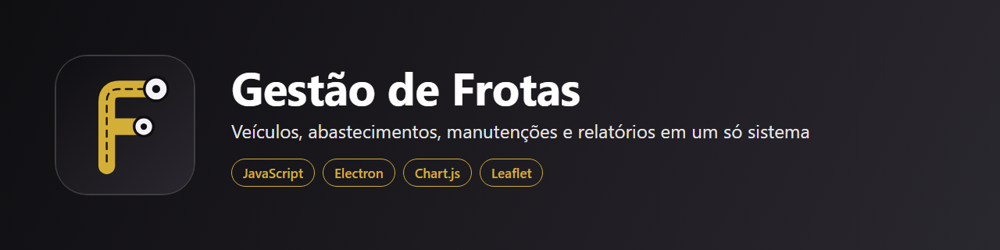

# Gestão de Frotas



Sistema para Windows que centraliza o controle de uma frota: veículos, abastecimentos, despesas, manutenções, alertas de vencimento, relatórios e visão dos veículos no mapa.

## Tecnologias

JavaScript, HTML, CSS, Electron, Chart.js e Leaflet.

## Como rodar

```
npm install
npm start        # abre o programa
npm run check    # confere a sintaxe
npm run smoke    # abre o programa e confere o funcionamento
```

O sistema começa vazio: não há dados de nenhuma empresa neste repositório.

## Autoria

Desenvolvido por Dayane Ferreira, com apoio de IA. Código publicado para avaliação do meu trabalho. Todos os direitos reservados.
